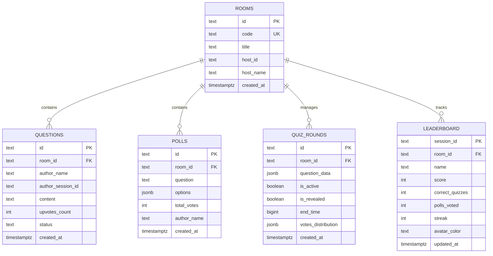

# ⚡ SKETCHCAST

> **High-Octane Real-Time Technical Quizzing, Live Voting, and Crowdsourced Q&A Arena.**  
> Built with React 18, TypeScript, Tailwind CSS v4, and Supabase Realtime & PostgreSQL.

---

## 🎨 Neo-Brutalism + Retro/Vintage Theme

SketchCast features a bold **Neo-Brutalist & 90s Arcade Aesthetic**:
- **Hard Zero-Blur Offset Drop Shadows**: `box-shadow: 4px 4px 0px #000;`
- **Saturated Arcade Color Palette**: Canary Yellow (`#FFE600`), Cyber Cyan (`#00F0FF`), Neon Pink/Coral (`#FF2A6D`), Mint Emerald (`#00F59B`), and Neon Orange (`#FF6B35`).
- **Tactile Mechanical Feedback**: Buttons physically depress upon click (`active:translate-x-[2px] active:translate-y-[2px] active:shadow-none`).
- **Custom Typography**: Loaded with `Space Grotesk`, `Archivo Black`, `Syne`, and `Space Mono`.
- **Retro Terminal Window Frames**: 3-dot window controls (`● ● ●`), hazard stripes, and stamped status badges.

---

## 🚀 Core Features

### 1. ⚡ Live Quiz Arena
- **Timed Rounds & Dynamic Countdown**: Real-time digital countdown with warning state animations.
- **Punch Option Cards (A, B, C, D)**: Chunky option buttons with instant selection state and live vote percentages.
- **Speed Bonus Scoring**: Earn higher points for rapid responses ($100 + \text{time ratio} \times 150$).
- **Streak Multipliers**: Consecutive correct answers grant $1.5\times$ and $2.0\times$ flame multipliers!
- **Technical Takeaway Breakdowns**: Post-reveal architecture explanations for every question.
- **Pre-Loaded Quiz Packs**: Instant access to System Design, Web Development, Cloud & DevOps, and AI/ML packs, plus custom quiz creation.

### 2. 🗳️ Live Community Polls
- Real-time consensus voting with animated percentage fill bars.
- Single-click atomic voting with instant percentage recalculation.
- Neo-Brutalist **"NEW POLL"** modal for hosts and attendees to launch questions.

### 3. 💬 Crowdsourced Q&A Upvote Feed
- Real-time question triage with chunky upvote buttons.
- Filter cassette tabs: `[★ TOP]`, `[⚡ NEW]`, `[🔥 STAGE]`, `[✓ DONE]`.
- Host spotlighting with hot-pink glowing borders (`S` key hotkey).

### 4. 🏆 Retro Arcade High Scores Podium
- Olympic-style podium (#1 Gold, #2 Cyan, #3 Orange) with streak flame badges.
- Live sorted player rankings synced across all devices.

### 5. 🛡️ Role-Gated Supabase Authentication
- **Verified Host/Admin Privileges**: Host and administrative controls require verified email sign-in / registration.
- **1-Click Guest Mode**: Frictionless guest join for attendees (no password required).
- **Auto-Auth & Session Retention**: Returning users with active sessions are automatically routed to the live arena.

---

## 🗄️ Supabase Database Architecture



---

## 🛠️ Tech Stack

- **Frontend**: React 18+, TypeScript, Vite
- **Styling**: Tailwind CSS v4, Custom CSS Design Tokens
- **Backend & Database**: Supabase (PostgreSQL 15+, Row Level Security, Auth, Storage)
- **Realtime**: Supabase Realtime Phoenix Channels & Broadcast API
- **Icons & Effects**: Lucide React, Canvas Confetti

---

## 📦 Getting Started

### 1. Clone the repository
```bash
git clone https://github.com/your-username/sketchcast.git
cd sketchcast
```

### 2. Install dependencies
```bash
npm install
```

### 3. Configure environment variables
Create a `.env` file from `.env.example`:
```bash
cp .env.example .env
```
Fill in your Supabase credentials:
```env
VITE_SUPABASE_URL=https://your-project-id.supabase.co
VITE_SUPABASE_ANON_KEY=your-anon-publishable-key-here
```

### 4. Apply Database Schema
Execute the SQL commands in `supabase/schema.sql` inside your Supabase project's **SQL Editor**.

### 5. Run local dev server
```bash
npm run dev
```
Open `http://localhost:5173` in your browser.

---

## 📁 Project Structure

```
SketchCast/
├── index.html                   # HTML template & Google Font imports
├── package.json                 # Dependencies & build scripts
├── vite.config.ts               # Vite configuration
├── .env.example                 # Environment variable template
├── .gitignore                   # Git ignore configuration
├── supabase/
│   └── schema.sql               # Database schema, RLS policies & seed data
├── src/
│   ├── main.tsx                 # React DOM entrypoint
│   ├── App.tsx                  # Root application & routing
│   ├── index.css                # Neo-Brutalism design system & utility classes
│   ├── types/
│   │   └── index.ts             # TypeScript definitions
│   ├── lib/
│   │   ├── supabase.ts          # Supabase client, Auth & DB helpers
│   │   ├── quizBank.ts          # Technical quiz packs & reference banks
│   │   └── realtime/
│   │       └── channelManager.ts# Realtime channel sync & presence tracking
│   ├── hooks/
│   │   ├── useRoomSession.ts    # Room presence, role & auth state
│   │   ├── useQuizEngine.ts     # Timers, scoring, streak multipliers & confetti
│   │   ├── usePollsEngine.ts    # Community polls & voting logic
│   │   └── useQAFeed.ts         # Live Q&A upvotes & spotlight filtering
│   └── components/
│       ├── auth/
│       │   └── LandingAuthPage.tsx  # Hero landing & authentication gateway
│       ├── common/
│       │   ├── AppHeader.tsx        # Retro arcade header & navigation
│       │   ├── AuthModal.tsx        # User profile & auth dialog
│       │   └── QRCodeModal.tsx      # Mobile join QR popover
│       ├── quiz/
│       │   ├── QuizArena.tsx        # Live quiz terminal & option buttons
│       │   ├── QuizHostPanel.tsx    # Cartridge pack launcher & quiz creator
│       │   └── LeaderboardPodium.tsx# Arcade high scores podium
│       ├── polls/
│       │   ├── LivePollsView.tsx    # Live voting cards & percentage bars
│       │   └── CreatePollModal.tsx  # Poll creator modal
│       └── qa/
│           ├── QuestionFeed.tsx     # Q&A list with retro folder tabs
│           ├── QuestionCard.tsx     # Upvote card with spotlight state
│           └── QuestionModal.tsx    # Question submission modal
```

---

## 📜 License
MIT License © 2026 SketchCast.
